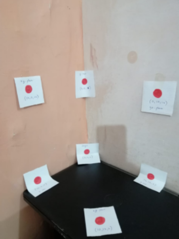

# Camera Calibration and 3D-to-2D Projection

## Project Overview

This project focuses on camera calibration, projection matrix estimation, and camera position recovery using Python.

The implementation uses computer vision and linear algebra techniques to establish the relationship between 3D world coordinates and 2D image pixel coordinates.

## Tasks

### Task 1: Camera Projection
- Construction of rotation matrices using yaw, pitch, and roll.
- Definition of camera intrinsic and extrinsic parameters.
- Computation of the projection matrix.
- Projection of 3D world points onto 2D image coordinates.
- Visualization of 3D world points and projected image points.

### Task 2: Projection Matrix Estimation
- Estimation of the camera projection matrix using Direct Linear Transformation (DLT).
- Singular Value Decomposition (SVD).
- Comparison between ground-truth and estimated projection matrices.
- Analysis of scale and sign ambiguity.

### Task 3: Camera Parameter Recovery
- Decomposition of the projection matrix using RQ decomposition.
- Extraction of camera intrinsic parameters.
- Recovery of rotation and translation matrices.
- Estimation of camera center.
- Evaluation of projection error.

### Additional Experiment: Image-Based Camera Calibration
- Manual selection of image points.
- Establishment of corresponding 3D world coordinates.
- Estimation of the projection matrix using SVD.
- Recovery of the camera position.
## Results and Visualizations

### 1. 3D Camera Visualization

This figure illustrates the 3D world points, camera position, and camera orientation.


### 2. 2D Camera Projection

This figure shows the projection of 3D world points onto the 2D image plane.


### 3. Original Input Image

The original image used for manual selection of corresponding pixel coordinates.



## Libraries Used
- Python
- NumPy
- Matplotlib
- SciPy
- OpenCV
- Jupyter Notebook / Google Colab

## Installation

Install the required libraries:

```bash
pip install numpy matplotlib scipy opencv-python
```

